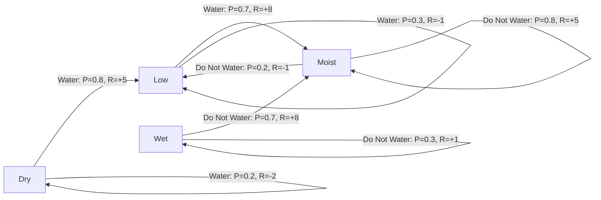

# Representation of a Real-World Problem as a Markov Decision Process

## Aim

To represent a smart irrigation system as a Markov Decision Process (MDP) by defining its states, actions, transition probabilities, reward function, and discount factor using Python.

## Problem Statement

### Problem Description

The selected real-world application is **Smart Irrigation System**.

A smart irrigation system monitors the moisture level of soil and decides whether plants need water. The system selects an appropriate action based on the current soil condition to prevent plants from drying out and avoid wasting water.

The objective is to maintain suitable soil moisture while using water efficiently.

## MDP Components

A Markov Decision Process is represented as:

\[
MDP=(S,A,P,R,\gamma)
\]

| Symbol | Meaning |
|---|---|
| \(S\) | Set of states |
| \(A\) | Set of actions |
| \(P\) | Transition probability function |
| \(R\) | Reward function |
| \(\gamma\) | Discount factor |

## State Space

The state space contains four possible soil moisture conditions.

\[
S=\{\text{Dry, Low, Moist, Wet}\}
\]

- **Dry:** The soil has very little water.
- **Low:** The soil needs additional water.
- **Moist:** The soil has sufficient moisture for plant growth.
- **Wet:** The soil contains excess moisture.

### Sample State

`Dry`

This state indicates that the soil needs watering to support healthy plant growth.

## Action Space

The available actions are:

\[
A=\{\text{Water Plants, Do Not Water}\}
\]

- **Water Plants:** The system activates the irrigation pump.
- **Do Not Water:** The system keeps the irrigation pump switched off.

### Sample Action

`Water Plants`

When the soil is dry, the system activates the pump to increase the soil moisture level.

## Transition Probability

The transition probability describes the probability of reaching a new soil condition after performing an action.

The general form is:

\[
P(s'\mid s,a)
\]

The following probabilities are assumed for this educational example.

| Current State | Action | Next State | Probability |
|---|---|---|---:|
| Dry | Water Plants | Low | 0.8 |
| Dry | Water Plants | Dry | 0.2 |
| Low | Water Plants | Moist | 0.7 |
| Low | Water Plants | Low | 0.3 |
| Moist | Do Not Water | Moist | 0.8 |
| Moist | Do Not Water | Low | 0.2 |
| Wet | Do Not Water | Moist | 0.7 |
| Wet | Do Not Water | Wet | 0.3 |

For example:

\[
P(\text{Low}\mid\text{Dry},\text{Water Plants})=0.8
\]

This means there is an 80% probability that watering dry soil will increase its moisture level to Low.

## Reward Function

The reward function gives feedback based on the action performed and the resulting soil condition.

The general form is:

\[
R(s,a,s')
\]

| Current State | Action | Next State | Reward |
|---|---|---|---:|
| Dry | Water Plants | Low | +5 |
| Dry | Water Plants | Dry | -2 |
| Low | Water Plants | Moist | +8 |
| Low | Water Plants | Low | -1 |
| Moist | Do Not Water | Moist | +5 |
| Moist | Do Not Water | Low | -1 |
| Wet | Do Not Water | Moist | +8 |
| Wet | Do Not Water | Wet | +1 |

Positive rewards encourage suitable soil moisture and efficient water use. Negative rewards indicate an unsuccessful watering attempt or an undesirable change in soil moisture.

## Discount Factor

The discount factor is:

\[
\gamma=0.9
\]

It determines the importance of future rewards compared with immediate rewards.

## Graphical Representation

The following graph illustrates the MDP states, actions, transition probabilities, and rewards.



## Python Representation

```python
# MDP Representation using Python

print("Name:Nitish Adavan ")
print("Register Number: ")

# State mapping
# 0 = Dry
# 1 = Low
# 2 = Moist
# 3 = Wet

states = {
    0: "Dry",
    1: "Low",
    2: "Moist",
    3: "Wet"
}

# Action mapping
# 0 = Water Plants
# 1 = Do Not Water

actions = {
    0: "Water Plants",
    1: "Do Not Water"
}

# Transition format:
# (probability, next_state, reward, done)

P = {
    0: {
        0: [
            (0.8, 1, 5, False),
            (0.2, 0, -2, False)
        ]
    },

    1: {
        0: [
            (0.7, 2, 8, False),
            (0.3, 1, -1, False)
        ]
    },

    2: {
        1: [
            (0.8, 2, 5, False),
            (0.2, 1, -1, False)
        ]
    },

    3: {
        1: [
            (0.7, 2, 8, False),
            (0.3, 3, 1, False)
        ]
    }
}

# Discount factor
gamma = 0.9

# Display the MDP
print("\nMDP: Smart Irrigation System")

print("States:")
for state_id, state_name in states.items():
    print(f"  {state_id}: {state_name}")

print("\nActions:")
for action_id, action_name in actions.items():
    print(f"  {action_id}: {action_name}")

# Display the transition dictionary
from pprint import pprint

print("\nTransition Dictionary P:")
pprint(P, width=100, sort_dicts=False)

# Validate transition probabilities
for state_id, action_dict in P.items():
    for action_id, outcomes in action_dict.items():
        total_probability = sum(
            transition[0] for transition in outcomes
        )

        assert abs(total_probability - 1.0) < 1e-9

print("\nDiscount factor (gamma):", gamma)
print("All transition probabilities are valid.")
```

## Output

```text
Name:Nitish Adavan D
Register Number:212224240107

MDP: Smart Irrigation System
States:
  0: Dry
  1: Low
  2: Moist
  3: Wet

Actions:
  0: Water Plants
  1: Do Not Water

Transition Dictionary P:
{0: {0: [(0.8, 1, 5, False), (0.2, 0, -2, False)]},
 1: {0: [(0.7, 2, 8, False), (0.3, 1, -1, False)]},
 2: {1: [(0.8, 2, 5, False), (0.2, 1, -1, False)]},
 3: {1: [(0.7, 2, 8, False), (0.3, 3, 1, False)]}}

Discount factor (gamma): 0.9
All transition probabilities are valid.
```

## Result

Thus, the smart irrigation system was successfully represented as a Markov Decision Process using four states, two possible actions, transition probabilities, a reward function, and a discount factor. The MDP was implemented using Python dictionaries, and all transition probabilities were validated. The model demonstrates how an intelligent system can make watering decisions to maintain suitable soil moisture and reduce water wastage.
